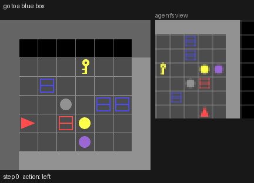
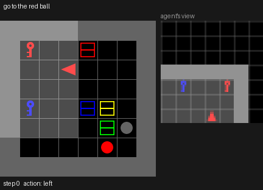

# Toy VLA on BabyAI

This project fine-tunes a small pretrained vision-language model (SmolVLM) into a
vision-language-action (VLA) policy for BabyAI. The policy reads the egocentric RGB frame,
the mission string and its recent actions, then emits one of MiniGrid's 7 action words.
The recipe follows RT-2 and OpenVLA at toy scale and is sized for a single RTX 2070
(8 GB, no bf16, no FlashAttention-2).

It implements the project plan *Toy VLA on BabyAI — Project Plan*. Milestones and status:

| Milestone | Code | Status |
|---|---|---|
| M1 Setup check | `toyvla/setup_check.py` | Done on the RTX 2070: full fine-tune of SmolVLM-256M at micro-batch 4 peaks at 6.2 GB |
| M2 Data | `toyvla/collect_demos.py`, `toyvla/data.py` | Done (GoToLocal, 10k episodes) |
| M3 Baseline | `toyvla/baseline.py` | Done; results below (CPU run) |
| M4 VLA SFT | `toyvla/vla.py`, `toyvla/train_vla.py` | SmolVLM-256M done on the RTX 2070; results below |
| M5 Ablations | `--history`, `--image-size` flags on `train_vla` | Done: history 0 and image size 256; results below |
| M6 Harder levels | `--level PickupLoc` / `GoToSeq` on every script | Done: baseline and SmolVLM-256M SFT on both; results below |
| M7 RL fine-tuning | `toyvla/rl.py` | Done: group-relative PPO from the 256M SFT model; results below |

## Setup

The project is managed with [uv](https://docs.astral.sh/uv/):

```bash
cd vla_babyai
uv sync                                                    # creates .venv; torch from PyTorch's cu126 index
uv run python -c "import torch; print(torch.cuda.is_available(), torch.version.cuda)"  # expect True 12.6
uv run pytest                                              # ~1 min; builds a tiny random SmolVLM-architecture model offline
git add uv.lock                                            # commit the lock produced on the GPU machine
```

`pyproject.toml` pulls torch and torchvision from the CUDA 12.6 wheel index on Linux. The
default PyPI torch is a CUDA 13 build, and the 2070's driver 535 (CUDA 12.2) cannot run CUDA 13.
CUDA 12.x wheels do run on it, through minor-version compatibility. After a driver upgrade to
570 or newer, switching the index URL to `cu128` also works.

Run every command from `vla_babyai/`, prefixed with `uv run` (e.g. `uv run python -m toyvla.collect_demos`). Data goes to `data/` and checkpoints to `runs/`;
both are git-ignored.

## Pipeline

Commands below are shown without the `uv run` prefix.

```bash
# M1: GPU info, then peak VRAM of one real training step at micro-batch 1, 2, 4, ... until OOM
python -m toyvla.setup_check --out runs/m1_256m.json
python -m toyvla.setup_check --model HuggingFaceTB/SmolVLM-500M-Instruct --lora-rank 16 --out runs/m1_500m_lora.json

# M2: bot demos + val and held-out splits (~1 min for 10k GoToLocal episodes)
python -m toyvla.collect_demos --level GoToLocal --episodes 10000
python -m toyvla.collect_demos --level GoToLocal --splits val            # add val to older data
# the same level with another held-out combo set (sets B and C used for replicates)
python -m toyvla.collect_demos --heldout-combos blue-ball,purple-key,red-box,grey-ball --out data/heldout_B
python -m toyvla.collect_demos --heldout-combos green-ball,yellow-key,purple-box,grey-key --out data/heldout_C

# M3: from-scratch baseline (trains, then evaluates all three splits)
python -m toyvla.baseline --data data/GoToLocal --out runs/baseline/GoToLocal

# M4: VLA SFT. SmolVLM-256M full fine-tune, then SmolVLM-500M + LoRA
python -m toyvla.train_vla --data data/GoToLocal --out runs/vla256/GoToLocal
python -m toyvla.train_vla --model HuggingFaceTB/SmolVLM-500M-Instruct --lora-rank 16 --lr 2e-4 \
    --data data/GoToLocal --out runs/vla500lora/GoToLocal

# Re-evaluate any checkpoint
python -m toyvla.evaluate --policy vla --ckpt runs/vla256/GoToLocal/final --data data/GoToLocal
python -m toyvla.evaluate --policy baseline --ckpt runs/baseline/GoToLocal/model.pt --data data/GoToLocal

# M5 ablations
python -m toyvla.train_vla --history 0 --out runs/vla256_h0/GoToLocal
python -m toyvla.train_vla --image-size 256 --out runs/vla256_r256/GoToLocal
python -m toyvla.train_vla --random-init --out runs/vla256_scratch/GoToLocal     # same architecture, no pretraining
python -m toyvla.train_vla --train-episodes 1000 --out runs/vla256_n1k/GoToLocal # first 1k demos only

# Language ablation on any level: each policy is given another episode's mission
python -m toyvla.evaluate --policy vla --ckpt runs/vla256/PickupLoc/final --data data/PickupLoc \
    --episodes 500 --shuffle-missions --out runs/shuffle_eval/vla256_PickupLoc.json

# M6 harder levels. GoToSeq episodes are ~67 bot steps, so 4k demos (~2.5 GB of frames) instead of 10k,
# and evaluation is cut at 512 steps (the level allows 2304) over 200 episodes per split.
python -m toyvla.collect_demos --level PickupLoc --episodes 10000
python -m toyvla.collect_demos --level GoToSeq --episodes 4000
python -m toyvla.baseline --data data/PickupLoc --out runs/baseline/PickupLoc --epochs 15 --eval-episodes 500
python -m toyvla.baseline --data data/GoToSeq --out runs/baseline/GoToSeq --epochs 15 --batch-size 16 \
    --eval-episodes 200 --eval-max-steps 512
python -m toyvla.train_vla --data data/PickupLoc --out runs/vla256/PickupLoc
python -m toyvla.train_vla --data data/GoToSeq --out runs/vla256/GoToSeq --final-eval-episodes 200 --eval-max-steps 512

# Replicates: one run per (training seed, held-out set), checkpoint picked by validation loss,
# then the mean and 95% interval across runs
python -m toyvla.train_vla --max-steps 4000 --eval-every 250 --seed 1 --data data/heldout_B/GoToLocal \
    --out runs/calib4k_B/GoToLocal
python -m toyvla.summarize runs/calib4k_A/GoToLocal runs/calib4k_B/GoToLocal runs/calib4k_C/GoToLocal

# Mission dropout: 10% of training missions replaced by a null mission; the final evaluation
# also runs classifier-free guidance at each weight (results_guidance<w>.json). Queue: runs/mdrop_gpu.sh
python -m toyvla.train_vla --max-steps 4000 --eval-every 250 --mission-dropout 0.1 --final-guidance 1.5 2 3 \
    --out runs/mdrop10_A/GoToLocal
python -m toyvla.evaluate --policy vla --ckpt runs/mdrop10_A/GoToLocal/best --guidance 2 --episodes 500

# M7: RL fine-tuning of the SFT model
python -m toyvla.rl --init runs/vla256/GoToLocal/final --data data/GoToLocal --out runs/vla256_rl/GoToLocal
```

## Design notes

**Data (M2).** The data comes from the BabyAI bot (`minigrid.utils.baby_ai_bot.BabyAIBot`)
on `RGBImgPartialObsWrapper` observations: the agent's 7×7 view at 8 px per cell, so 56×56 RGB.
Only successful bot episodes are kept. There are three splits:

- `train`: seeds from 0 upward. Missions naming a held-out color–object combo are skipped.
- `test_seeds`: seeds from 10,000,000 upward, using training combos only.
- `test_combos`: seeds from that same test range whose mission names a held-out combo.
  The defaults are red ball, green key, blue box and yellow ball (`--heldout-combos`).
  These objects can still appear as distractors in training scenes; only instructions
  that name them are held out.

Each split stores frames, actions, episode boundaries, seeds and missions. A seed fully
determines the level, so evaluation re-creates each episode from its seed. The stored bot
episode length is the reference for the length metric.

**Seeds.** Two unrelated kinds of seed appear in this project, and "seed" alone is ambiguous.

- **Level seed:** the integer passed to `env.reset(seed=...)`. It fully determines one BabyAI
  level: room layout, objects, agent start and mission. Ranges: demos from 0 upward, RL levels
  1,000,000–9,000,000, test levels from 10,000,000 upward. "Seen seeds" and "held-out seeds" in
  the tables mean training levels and new test levels.
- **Training seed** (`--seed` on `train_vla`, `baseline`, `rl`): PyTorch's random number
  generator for one training run. For a pretrained model it sets only the order in which
  training examples are drawn; with `--random-init` it also sets the initial weights; in `rl` it
  also picks the RL levels and the sampled actions. "Seed 0 vs seed 1" in the results means two
  training runs with identical settings and data.

Evaluation itself has no randomness: the policy takes the argmax action on a fixed list of level
seeds (the first N of each split), so re-evaluating a checkpoint gives the same numbers.

**Validation and checkpoint selection.** `val` holds 500 levels from seed 9,000,000 upward,
training combos only. With a `val` split, `train_vla` rolls the model out on `--eval-episodes`
validation levels and measures its loss on the first `--val-steps` validation examples every
`--eval-every` updates (and at the end). It keeps the checkpoint with the lowest validation loss
in `best/`, evaluates that one, and records the choice in `selection.json`. The test splits are
never used for selection. Runs before 2026-10-19 had no `val` split and used the last checkpoint.

**Evaluation.** Each table column is a success rate on one split: training seeds ("seen"),
`test_seeds` and `test_combos`. `length_ratio` is the mean of policy steps ÷ bot steps over
successful episodes; a value above 1 means the policy wanders. On GoTo levels,
`direct_success_rate` counts only episodes solved without facing any other object first (see
"Diagnosing the wandering"); it is the main GoTo metric from 2026-10-19 on, because plain
success also rewards turning to face objects until one matches. Every rate comes with a 95%
Wilson interval (`*_ci95`), which covers evaluation noise only, not run-to-run spread. Environments run in parallel
batches, so the VLA forward pass is batched too.

**Baseline (M3).** The model follows the BabyAI paper: a GRU instruction encoder, a conv stem,
two FiLM-conditioned residual conv blocks, max-pooling, a GRU memory over time and an MLP
actor. It is trained with behavior cloning on whole episodes and sees the same RGB frames as
the VLA.

**VLA (M4)** (`toyvla/vla.py`):

- **Prompt.** SmolVLM's chat template, holding the frame, `Mission: …`, the last
  `--history` actions as words (`Recent actions: left forward`) and the list of valid
  actions. It ends at `Assistant:`.
- **Action head.** The language-model head is the action head. The target is the first
  token of ` <action word>`. The code checks at load time that the 7 first tokens are
  distinct.
- **Loss.** Cross-entropy over the full vocabulary, at the last prompt position only.
  Left padding puts that position at index −1 for every row, and the model returns
  logits only there (`logits_to_keep=1`).
- **Inference.** Argmax over the 7 action-token logits only, i.e. constrained decoding.
  These 7 logits are also the categorical policy that M7's RL fine-tunes.
- **Images.** No image splitting: each frame is upscaled with nearest neighbour to
  `--image-size` (default 512, giving 64 image tokens for SmolVLM-256M) and encoded as
  one tile. `--image-size 256` gives 16 tokens. That is the main lever on sequence length.
- **Precision and memory.**
  - fp32 master weights, fp16 autocast and `GradScaler` (Turing has no bf16).
  - SDPA attention.
  - Micro-batch 4 × 16 accumulation steps = an effective batch of 64.
  - `--grad-checkpointing` and `--freeze-vision` when memory is tight.
  - The training log records the count of non-finite losses and the loss scale, to catch
    fp16 overflow.
- **LoRA.** `--lora-rank r` puts adapters on every attention and MLP projection. At the end
  they are merged into the weights, so a checkpoint always loads as a plain model.

## Results — BabyAI-GoToLocal

Success rate (episode length ÷ bot length) over 500 episodes per split.

| Policy | Seen seeds | Held-out seeds | Held-out color–object combos |
|---|---|---|---|
| BabyAI CNN+GRU+FiLM, from scratch | 0.998 (1.05) | 0.998 (1.06) | 0.536 (3.15) |
| SmolVLM-256M, SFT | 0.992 (1.05) | 0.992 (1.06) | 0.652 (4.96) |
| SmolVLM-500M + LoRA, SFT | 0.980 (1.26) | 0.962 (1.28) | 0.680 (4.45) |
| SmolVLM-256M SFT + RL (M7) | 0.994 (1.00) | 0.990 (1.00) | 0.626 (4.18) |

The baseline row comes from a CPU run: 15 epochs, 64 channels, 10k demos, about 45 minutes, final
training action accuracy 0.989. It generalizes across seeds but not to unseen instruction
combinations. On held-out combos it succeeds about half the time and takes about 3× the bot's
steps when it does. That gap is what the VLA's language pretraining should close.

The SmolVLM-256M row: 2000 updates at an effective batch of 64 (about 2.4 epochs), on the
RTX 2070 in 2 h 7 min, peak VRAM 6.2 GB, with no fp16 overflow. Final training loss was 0.058
and action accuracy 0.983. On held-out combos it succeeds more often than the baseline
(65.2% vs 53.6%; about ±2 points of standard error at 500 episodes). But it takes about 5× the
bot's steps when it does, so part of that success comes from wandering until it happens to
face the right object rather than heading straight for it. Both models are at about 99% on
seeds they did not train on.

The SmolVLM-500M + LoRA row: rank 16, lr 2e-4, otherwise the same settings. Its 68.0% on held-out
combos is not clearly better than 256M's 65.2%: the gap is about one standard error of the
difference (±3 points). It is clearly worse on seeds it trained on or that are held out (about
97% vs 99%) and takes about 1.3× the bot's steps there instead of 1.05×. So LoRA at this rank
and learning rate fits the training distribution less closely than full fine-tuning of the
smaller model.

## M5: ablations on GoToLocal

SmolVLM-256M, full fine-tune, same settings as the SFT row above (2000 updates, effective batch
64), changing one knob at a time. 500 episodes per split.

| Variant | Final train loss / action acc | Seen seeds | Held-out seeds | Held-out combos | Train time |
|---|---|---|---|---|---|
| History 4, 512 px (64 image tokens), the SFT row above | 0.058 / 0.983 | 0.992 (1.05) | 0.992 (1.06) | 0.652 (4.96) | 2 h 7 min |
| History 0 | 0.289 / 0.895 | 0.858 (1.16) | 0.872 (1.12) | 0.064 (1.47) | 2 h 21 min |
| Image size 256 (16 image tokens) | 0.414 / 0.808 | 0.714 (2.93) | 0.726 (2.88) | 0.434 (3.95) | 1 h 28 min |

Both knobs matter, and history matters most for generalization.

- **History 0.** With no past actions, held-out combo success falls from 65% to 6%. The policy
  sees only the current frame, so it cannot tell that it has just turned past something or has
  been spinning in place. A likely reading, not yet checked with rollouts: on an unseen combo it
  falls into a loop and times out. The short length ratio (1.47) on the few successes says that it only succeeds when it is
  already nearly facing the target. Even on training seeds it loses 13 points. The bot's next
  action is not a function of the frame alone, and training accuracy stops at 0.90.
- **Image size 256.** Training accuracy stops at 0.81, and episodes run about 3× the bot's
  length even on seen seeds. The vision encoder still sees each cell across several 16 px
  patches, but the connector's pixel shuffle then packs the 7×7 view into a 4×4 grid of tokens,
  so each token mixes about two cells. At 512 px it is 8×8, finer than one token per cell, which
  is the likely reason 64 tokens work and 16 do not. The 256 px run is only 1.4× faster
  per step, because the language model and the fixed per-step overheads dominate.

## M6: harder levels

`PickupLoc` ("pick up the red ball") has the same 8×8 single room as GoToLocal, but the agent
must face the object and then pick it up. `GoToSeq` chains two to four GoTo instructions with
"and", "then" and "after you" across a 3×3 grid of rooms with doors (22×22 cells); the bot needs
about 67 steps (90 on held-out combos). GoToSeq uses 4k demos and a 512-step evaluation cutoff
over 200 episodes per split (see the commands above). Held-out combos are the same four; a
GoToSeq mission is held out if any of its parts names one.

| Level | Policy | Seen seeds | Held-out seeds | Held-out combos |
|---|---|---|---|---|
| PickupLoc | BabyAI CNN+GRU+FiLM, from scratch | 0.966 (1.05) | 0.942 (1.03) | 0.290 (1.68) |
| PickupLoc | SmolVLM-256M, SFT | 0.976 (1.05) | 0.974 (1.09) | 0.962 (1.63) |
| GoToSeq | BabyAI CNN+GRU+FiLM, from scratch | 0.600 (3.34) | 0.550 (3.65) | 0.265 (4.17) |
| GoToSeq | SmolVLM-256M, SFT | 0.450 (8.03) | 0.420 (3.90) | 0.220 (4.78) |
| GoToSeq | SmolVLM-256M, SFT, history 16 | 0.530 (8.46) | 0.505 (4.99) | 0.290 (3.95) |

The baselines ran on the CPU (15 epochs; PickupLoc 44 min, GoToSeq 3.5 h at 16 episodes per
batch to fit in RAM).

The VLA rows use the GoToLocal SFT settings (2000 updates at an effective batch of 64): PickupLoc
took 2 h 9 min (final training loss 0.046, action accuracy 0.984), GoToSeq 2 h 34 min (0.26,
0.90). Peak VRAM was 6.2–6.3 GB, with no fp16 overflow.

- **PickupLoc: the VLA generalizes to unseen combos almost fully.** It succeeds on 96% of held-out
  combos, against the baseline's 29% and its own 65% on GoToLocal. Standard error at 500
  episodes is under 1 point for the VLA and about 2 for the baseline, so the gap is real. Picking
  up a wrong object does not end the episode here, so the length ratio of 1.6 likely includes
  some drop-and-retry. A language ablation confirms the policy reads these
  instructions (see "Pretraining, data and history ablations" below).
- **GoToSeq: both policies fail often, and the VLA does worse in-distribution.** The VLA succeeds
  on 45% of seen seeds against the baseline's 60%, and on 42% of held-out seeds against 55%
  (about ±5 points of standard error at 200 episodes). On held-out combos the two are level
  (22% vs 26.5%). A GoToSeq mission needs memory of which sub-goals are done. The baseline has a
  GRU over the whole episode; the VLA sees only the current frame and its last 4 actions, so it
  cannot know where it is in the sequence. Its training action accuracy stops at 0.90, as does
  the history-0 ablation's on GoToLocal, which also lacks information it needs. A history of 16
  actions (2 h 35 min, 6.3 GB) raises success by 7–8 points on every split, about 1.5 standard
  errors each at 200 episodes and within the seed spread seen on GoToLocal. Training accuracy stays at
  0.91, so the last 16 actions still do not tell the policy which sub-goals are done. Past frames
  in the prompt or a sub-goal counter would be the next things to try.

The length ratios here are biased low for the weaker policies, because the 512-step cutoff turns
the longest wandering episodes into failures.

## M7: RL fine-tuning

`toyvla/rl.py` fine-tunes the SmolVLM-256M SFT model with a group-relative PPO (GRPO without
its KL term):

- **Policy.** The softmax over the 7 action-token logits, the same distribution that SFT trains
  and greedy evaluation takes the argmax of. Rollouts sample from it at temperature 1.
- **Levels.** Each iteration draws 8 fresh seeds from a range that neither the demos nor the
  test splits use (from 1,000,000), skipping missions that name a held-out combo. RL therefore
  never sees the held-out instructions either.
- **Reward and advantage.** BabyAI's own reward, 1 − 0.9 × steps / max_steps on success and 0 on
  failure, so a shorter success scores higher. 8 episodes per seed; advantage = (reward − group
  mean) / group std. Seeds where all 8 episodes got the same reward are dropped.
- **Update.** 2 epochs of the PPO clipped objective (clip 0.2) over every step of the kept
  episodes, averaged per step, with the rollout log-probabilities as the old policy. lr 2e-6,
  256 steps per optimizer update, fp16 autocast with `GradScaler` as in SFT.

The run: 100 iterations (6,400 episodes) in 45 min on the RTX 2070, peak VRAM 6.2 GB, no fp16
overflow. Results are the "SFT + RL" row of the GoToLocal table.

- **On training-distribution levels RL did what the reward asks.** Episodes got shorter: the
  length ratio on seen and held-out seeds went from 1.05 to 1.00, so the policy now matches the
  bot's step count, while success stayed at 99%.
- **On held-out combos it did nothing.** Success went from 65.2% to 62.6%, inside the noise
  (about ±3 points for the difference), and the length ratio stayed at about 4.2. The training
  signal was thin: the SFT model already succeeds on almost every training mission, so only
  about 2 of the 8 seeds per iteration had any reward spread, all of it about path length. RL on
  the training instructions shortens paths there, but it does not teach the policy anything
  about grounding instructions it has never seen.

To move held-out combos, RL would need either a weaker starting point with room to improve on
training missions, or rollouts on the held-out instructions themselves, which would end the
held-out evaluation.

## Pretraining, data and history ablations

SmolVLM-256M on GoToLocal, same settings as the SFT row (2000 updates at an effective batch of 64,
about 2 h 10 min each on the RTX 2070, peak VRAM 6.2 GB, no fp16 overflow), changing one thing at a
time. 500 episodes per split. "Wrong mission" is success when the policy is given another target's
mission (`--shuffle-missions`), on held-out combos.

| Variant | Train loss / action acc | Seen seeds | Held-out seeds | Held-out combos | Held-out combos, wrong mission |
|---|---|---|---|---|---|
| Pretrained, 10k demos, history 4 (the SFT row) | 0.058 / 0.983 | 0.992 (1.05) | 0.992 (1.06) | 0.652 (4.96) | 0.58 |
| Same settings, seed 1 (`--seed 1`) | 0.138 / 0.944 | 0.982 (1.29) | 0.964 (1.22) | 0.536 (4.79) | |
| Random init (`--random-init`), lr 5e-5 | 0.416 / 0.805 | 0.764 (3.55) | 0.780 (3.12) | 0.572 (3.85) | 0.58 |
| Random init, lr 3e-4 | 0.480 / 0.786 | 0.596 (3.69) | 0.596 (3.00) | 0.548 (3.39) | |
| 3k demos (`--train-episodes 3000`, 8 epochs) | 0.053 / 0.977 | 0.996 (1.09) | 0.962 (1.37) | 0.622 (4.01) | |
| 1k demos (24 epochs) | 0.000 / 1.000 | 1.000 (1.00) | 0.914 (1.54) | 0.708 (3.08) | |
| History 8 | 0.167 / 0.938 | 0.978 (1.27) | 0.974 (1.26) | 0.552 (4.72) | |

- **Two runs with identical settings differ by 12 points on held-out combos** (65.2% with seed 0,
  53.6% with seed 1), several times the ±2 points of evaluation noise. Seed 1 also fits the
  training set less closely (0.94 vs 0.98 action accuracy). The seed sets the data order, so the
  held-out combo number depends heavily on the training run, and every single-run gap on that
  column below is within this spread.
- **Without pretraining the model ignores the instruction.** The random-init model succeeds as
  often with a wrong mission as with the true one, on held-out seeds too (79% vs 78%). It has
  learned to roam, not to read. A higher learning rate makes it worse, so this is not just a
  learning rate set for fine-tuning. The BabyAI baseline learns the instruction from the same
  demos, so the issue is a 256M transformer trained from scratch for 2000 updates.
- **About 57% is the roaming floor on held-out combos.** The random-init model gets 57%, and the
  pretrained VLA given a wrong mission gets 58%. Pretraining adds 7–8 points on top of that, about
  2.5 standard errors of evaluation noise, but the seed-1 run (54%) falls below the random-init
  model. Pretraining is what lets the VLA read instructions at all (96–99% vs 78% on held-out
  seeds), but on unseen GoTo combos it adds nothing that survives the run-to-run spread.
- **More demos help held-out seeds, not held-out combos.** Held-out seed success rises from 91% at 1k
  demos to 99% at 10k. Held-out combos stay between 62% and 71%, within noise of each other (about
  ±2 points each). The 1k run fits its training set exactly and still generalizes to new combos as
  well as the others.
- **History 8 vs history 4 is not resolved.** History 8 gets 55% on held-out combos, between the two
  history-4 seeds (65% and 54%), with the same 0.94 training accuracy as seed 1.

**PickupLoc: the VLA does read unseen instructions.** Success with the true mission and with
another target's mission, 500 episodes per split:

| Policy | Seen seeds | Held-out seeds | Held-out combos |
|---|---|---|---|
| BabyAI CNN+GRU+FiLM, from scratch | 0.966 / 0.088 | 0.942 / 0.068 | 0.290 / 0.026 |
| SmolVLM-256M, SFT | 0.976 / 0.092 | 0.974 / 0.104 | 0.962 / 0.039 |
| SmolVLM-256M, random init | 0.268 / 0.215 | 0.236 / 0.237 | 0.070 / 0.068 |

On PickupLoc a wrong mission drops the VLA from 96% to 4% on held-out combos, so its success there
comes from reading the instruction, unlike on GoToLocal. In an 8×8 room with a few objects, a GoTo
policy can succeed by turning to face objects until one matches. A pickup policy has to choose the
object to pick up. The random-init model fails PickupLoc almost entirely (7% on held-out combos), so
pretraining is what makes the 96% possible.

## Calibration: training budget, seeds and held-out sets

SmolVLM-256M SFT on GoToLocal, 4000 updates, validation every 250, checkpoint picked by
validation loss. Sets B and C are listed under M2 in "Pipeline"; set A is the original
(red ball, green key, blue box, yellow ball). 500 episodes per split; the bot's direct success
is 68–69% on every split.

| Held-out set | Training seed | Selected step | Held-out seeds: success / direct | Held-out combos: success / direct |
|---|---|---|---|---|
| A | 0 | 3250 | 1.000 / 0.692 | 0.536 / 0.160 |
| A | 1 | 3500 | 0.994 / 0.682 | 0.730 / 0.326 |
| A | 2 | 3750 | 0.998 / 0.688 | 0.794 / 0.506 |
| B | 1 | 4000 | 0.996 / 0.690 | 0.890 / 0.548 |
| C | 2 | 3250 | 0.988 / 0.686 | 0.876 / 0.466 |

- **The old 2000-update budget undertrained.** Validation loss stops improving at 3000–3250
  updates (0.04, against 0.08–0.10 at 2000). 4000 updates take about 4 h 25 min.
- **In distribution the policies match the bot**: 99–100% on held-out seeds, direct success at
  the bot's level.
- **Held-out combo success depends on both the training seed and the held-out set.** On set A
  the seed alone moves it by 26 points (54% to 79%), and the best set-A run is still below
  sets B and C. Every set-A number in earlier sections comes from seed 0, the worst of the three.
- **The failures differ by set** (`toyvla.diagnose`). Set A, seed 0 fails evenly on all four
  targets (52–55%), and 54% of the wrong objects it faces share neither color nor type with the
  target: it roams. Sets B and C fail on one or two pairs (B: grey ball 63%; C: grey key 77%,
  yellow key 78%); the others score 92–100%.

So a held-out combo comparison needs several training seeds per held-out set, reported per set.

## Rollouts

`toyvla.render` writes one GIF per episode. Each shows the top-down level, with the agent's
field of view highlighted, next to the 56×56 frame the policy actually receives. The mission
is at the top, the chosen action at the bottom, and the last frame states the outcome and the
bot's step count for the same seed.

```bash
python -m toyvla.render --policy vla --ckpt runs/vla256/GoToLocal/final --split heldout_combos --episodes 4
python -m toyvla.render --policy vla --ckpt runs/vla256/GoToLocal/final --split heldout_combos --select fail
```

The baseline on held-out color–object combos (GIFs written to `media/<policy>_<level>/`):

| "go to a blue box": success, 7 steps vs the bot's 3 | A failure: timeout after 64 steps |
|---|---|
|  |  |

## Diagnosing the wandering

`toyvla.diagnose` replays each evaluation episode and records every object the agent faces.
A GoTo episode ends in success the moment the agent faces a matching object; facing any other
object does nothing. Each wrong object faced is classed by its relation to the instruction:
same color, same type, or neither. `--policy bot` replays the recorded demos as the reference.
Even the bot faces a non-target object before its target in about 30% of episodes, because it
turns past objects on the way.

```bash
python -m toyvla.diagnose --policy bot
python -m toyvla.diagnose --policy baseline --ckpt runs/baseline/GoToLocal/model.pt
python -m toyvla.diagnose --policy vla --ckpt runs/vla256/GoToLocal/final
python -m toyvla.diagnose --policy vla --ckpt runs/vla256/GoToLocal/final --shuffle-missions
```

Results on held-out color–object combos, 500 episodes. "Solved directly" is the success
rate times the share of successes with no wrong object faced first.

| | Bot | Baseline | SmolVLM-256M |
|---|---|---|---|
| Success | 100% | 54% | 65% |
| Successes with no wrong object faced first | 68% | 49% | 27% |
| Episodes solved directly | 68% | 26% | 18% |
| Wrong objects faced per success | 0.41 | 0.94 | 1.94 |
| Wrong objects faced per failure | — | 3.19 | 6.82 |
| Failures that never faced an object | — | 20% | 5% |
| Success, target in view at start / hidden | 100% / 100% | 58% / 49% | 68% / 62% |
| Wrong objects with the target's color / type | 10% / 35% | 12% / 41% | 24% / 26% |

On held-out seeds both models look like the bot: about 68–69% of successes are direct, with
about 0.4 wrong objects per success.

The VLA's higher success on unseen instructions comes from persistence, not better
grounding. It solves fewer episodes directly than the baseline (18% vs 26%). Instead it keeps
visiting objects until it faces a match, while the baseline more often gets stuck. The
wrong objects it visits share the instruction's color twice as often as the bot's (24% vs
10%), so it picks up the color word but not the object type.

**Language ablation** (`--shuffle-missions`). Each policy is given another episode's
mission, while the environment still rewards the true one. The table shows success on
episodes whose given mission names a different target:

| | True mission | Another target's mission |
|---|---|---|
| Baseline, held-out seeds | 100% | 25% |
| Baseline, held-out combos | 54% | 36% |
| SmolVLM-256M, held-out seeds | 99% | 54% |
| SmolVLM-256M, held-out combos | 65% | 58% |

On held-out seeds, whose instructions use combinations seen in training, the baseline clearly
follows the instruction. On held-out combos,
36 of its 54 points survive a wrong instruction, so they come from roaming into the target
rather than from reading the mission.

The VLA follows the instruction on held-out seeds too (99% falls to 54%). On held-out combos,
58 of its 65 points survive a wrong instruction. The true mission adds about 7 points, roughly
two standard errors, so the VLA barely uses an instruction it has not seen. Its edge over the
baseline on held-out combos (65% vs 54%) comes from roaming more persistently, not from
grounding the new color–object pairs: given a wrong mission it still succeeds 58% of the time,
against the baseline's 36%.

Success on held-out combos by target:

| Held-out combo | Episodes | Baseline success | SmolVLM-256M success |
|---|---|---|---|
| yellow ball | 127 | 89% | 59% |
| blue box | 126 | 67% | 79% |
| green key | 116 | 29% | 67% |
| red ball | 131 | 28% | 56% |

